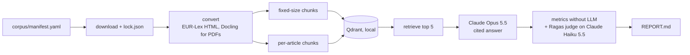

# EU AML RAG Evaluation

[](https://github.com/ricardorfaria1/eu-bank-rag-eval/actions/workflows/ci.yml)

[Português](README.pt.md)

A retrieval-augmented assistant for the compliance team of a fictional Portuguese bank, answering questions about EU and Portuguese anti-money laundering rules with citations to the article they come from. The same assistant is built in three configurations and evaluated on one reviewed test set, so the report can say which design choice improved what, and whether a failure came from retrieval or from the answer.

Answers are not legal advice. Always check the official text.

## Architecture



## Corpus

| Id | Document | Language | Source |
|---|---|---|---|
| AMLR | Regulation (EU) 2024/1624 | EN | EUR-Lex |
| AMLD6 | Directive (EU) 2024/1640 | EN | EUR-Lex |
| AMLA-R | Regulation (EU) 2024/1620 (AMLA) | EN | EUR-Lex |
| EBA-RF | EBA Guidelines on ML/TF risk factors (consolidated) | EN | EBA |
| EBA-RO | EBA Guidelines on remote customer onboarding | EN | EBA |
| L83-2017 | Lei n.º 83/2017 | PT | Portal das Finanças |
| L97-2017 | Lei n.º 97/2017 (restrictive measures) | PT | Diário da República, manual download |
| L72-2025 | Lei n.º 72/2025 (amends Lei 97/2017) | PT | Portal das Finanças |
| BdP-A1-2022 | Aviso do Banco de Portugal n.º 1/2022 | PT | Banco de Portugal |
| BdP-A1-2023 | Aviso do Banco de Portugal n.º 1/2023 | PT | Banco de Portugal |
| BdP-A3-2024 | Aviso do Banco de Portugal n.º 3/2024 | PT | Banco de Portugal |
| BdP-I8-2024 | Instrução do Banco de Portugal n.º 8/2024 | PT | Banco de Portugal |
| CMVM-R2-2020 | Regulamento da CMVM n.º 2/2020 | PT | CMVM, manual download |

Documents are downloaded from the official sources, never committed. `data/raw/lock.json` records the sha256 and retrieval date of each file used. Two documents have no stable download URL; save them by hand as `data/raw/L97-2017.pdf` and `data/raw/CMVM-R2-2020.pdf`. The reuse basis for each source is in `corpus/manifest.yaml`.

## Configurations

| Config | Chunking | Retrieval |
|---|---|---|
| `baseline` | 1000 characters, 150 overlap | dense (BGE-M3) |
| `by-article` | one chunk per article (EBA: per guideline) | dense (BGE-M3) |
| `by-article-hybrid` | one chunk per article | dense + BM25 |

Each is a YAML file in `configs/`. Adding a configuration means adding a file.

## Test set

- Candidates generated by Ragas from the corpus, about 60% in European Portuguese, then reviewed by a person ([review guide](docs/REVIEW_GUIDE.md)). Only reviewed rows are evaluated.
- 10 hard cases written by hand from the source text: questions that need two documents, a Portuguese question about an English text, revoked rules, rules that differ between supervisors (Banco de Portugal and CMVM), and out-of-scope questions that must be refused.

## Metrics

| Metric | Needs an LLM | What it shows |
|---|---|---|
| Hit@5, MRR | no | Did retrieval find the expected article, and how high? |
| Citation recall | no | Does the answer cite the articles it should? |
| Citation precision | no | Do its citations point to excerpts it actually received? |
| Correct refusals | no | Out-of-scope questions answered with "not found" |
| Faithfulness (Ragas) | yes | Is every claim supported by the excerpts? |
| Factual correctness (Ragas) | yes | Does the answer match the reviewed reference? |

Every metric is reported with a 95% bootstrap interval over questions, and each configuration is compared with the baseline question by question. A difference whose interval contains zero is reported as inconclusive.

The Ragas judge is checked against a second, blind grading of 20 answers; the report shows the agreement and Cohen's kappa.

## Results

See [REPORT.md](REPORT.md) after the first full run.

## Running

Needs [uv](https://docs.astral.sh/uv/). The first `ingest` downloads BGE-M3 (about 2 GB) and Docling models.

```bash
uv sync
```

```bash
uv run eurag ingest
```

Paid steps need `ANTHROPIC_API_KEY`. Each prints an estimate and asks before spending; a ledger in `results/budget.json` stops at 25 USD in total.

```bash
uv run eurag testset --n 80
```

```bash
uv run eurag testset --merge
```

```bash
uv run eurag run --config all
```

```bash
uv run eurag evaluate --config all
```

```bash
uv run eurag report
```

Answers are cached per configuration, so an interrupted run resumes without paying again, and a changed configuration never reuses old answers.

Offline tests (no API, no model downloads):

```bash
uv run pytest
```

## Limitations

- The judge (Claude Haiku) is from the same model family as the answer model (Claude Opus), which can favour the answers.
- About 50 questions: small differences will often be inconclusive.
- References are reviewed by one person.
- Lei 83/2017 is the version republished by Lei 58/2020; later amendments are not included.

## Next steps

- Experiment tracking (MLflow or Langfuse) for runs, prompts and costs.
- An A/B test design comparing two configurations with live users, in a separate project.
