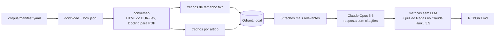

# Avaliação de RAG sobre regulamentação de branqueamento de capitais

[](https://github.com/ricardorfaria1/eu-bank-rag-eval/actions/workflows/ci.yml)

[English](README.md)

Assistente com recuperação de documentos (RAG) para a equipa de compliance de um banco português fictício. Responde a perguntas sobre as regras europeias e portuguesas de prevenção do branqueamento de capitais, citando o artigo de onde vem cada afirmação. O mesmo assistente é construído em três configurações e avaliado com um único conjunto de teste revisto, para o relatório mostrar que escolha melhorou o quê e se cada falha veio da pesquisa ou da resposta.

As respostas não são aconselhamento jurídico. Confirme sempre no texto oficial.

## Arquitetura



## Corpus

| Id | Documento | Língua | Fonte |
|---|---|---|---|
| AMLR | Regulamento (UE) 2024/1624 | EN | EUR-Lex |
| AMLD6 | Diretiva (UE) 2024/1640 | EN | EUR-Lex |
| AMLA-R | Regulamento (UE) 2024/1620 (AMLA) | EN | EUR-Lex |
| EBA-RF | Orientações da EBA sobre fatores de risco de BC/FT (consolidadas) | EN | EBA |
| EBA-RO | Orientações da EBA sobre onboarding remoto de clientes | EN | EBA |
| L83-2017 | Lei n.º 83/2017 | PT | Portal das Finanças |
| L97-2017 | Lei n.º 97/2017 (medidas restritivas) | PT | Diário da República, download manual |
| L72-2025 | Lei n.º 72/2025 (altera a Lei 97/2017) | PT | Portal das Finanças |
| BdP-A1-2022 | Aviso do Banco de Portugal n.º 1/2022 | PT | Banco de Portugal |
| BdP-A1-2023 | Aviso do Banco de Portugal n.º 1/2023 | PT | Banco de Portugal |
| BdP-A3-2024 | Aviso do Banco de Portugal n.º 3/2024 | PT | Banco de Portugal |
| BdP-I8-2024 | Instrução do Banco de Portugal n.º 8/2024 | PT | Banco de Portugal |
| CMVM-R2-2020 | Regulamento da CMVM n.º 2/2020 | PT | CMVM, download manual |

Os documentos são descarregados das fontes oficiais e nunca entram no repositório. O ficheiro `data/raw/lock.json` regista o sha256 e a data de cada ficheiro usado. Dois documentos não têm endereço de download estável; guarde-os à mão como `data/raw/L97-2017.pdf` e `data/raw/CMVM-R2-2020.pdf`. A base de reutilização de cada fonte está em `corpus/manifest.yaml`.

## Configurações

| Configuração | Divisão | Pesquisa |
|---|---|---|
| `baseline` | 1000 caracteres, 150 de sobreposição | semântica (BGE-M3) |
| `by-article` | um trecho por artigo (EBA: por orientação) | semântica (BGE-M3) |
| `by-article-hybrid` | um trecho por artigo | semântica + BM25 |

Cada uma é um ficheiro YAML em `configs/`. Acrescentar uma configuração é acrescentar um ficheiro.

## Conjunto de teste

- Perguntas candidatas geradas pelo Ragas a partir do corpus, cerca de 60% em português europeu, revistas depois por uma pessoa ([guia de revisão](docs/REVIEW_GUIDE.md)). Só as linhas revistas são avaliadas.
- 10 casos difíceis escritos à mão a partir do texto oficial: perguntas que precisam de dois documentos, uma pergunta em português sobre um texto em inglês, normas revogadas, regras que mudam entre supervisores (Banco de Portugal e CMVM) e perguntas fora do âmbito, que devem ser recusadas.

## Métricas

| Métrica | Precisa de LLM | O que mostra |
|---|---|---|
| Hit@5, MRR | não | A pesquisa encontrou o artigo esperado, e em que posição? |
| Recall de citações | não | A resposta cita os artigos que devia? |
| Precisão de citações | não | As citações apontam para trechos que a resposta recebeu? |
| Recusas corretas | não | Perguntas fora do âmbito respondidas com "não encontrei" |
| Faithfulness (Ragas) | sim | Cada afirmação está apoiada nos trechos? |
| Factual correctness (Ragas) | sim | A resposta bate com a referência revista? |

Cada métrica vem com um intervalo de confiança de 95% por bootstrap sobre as perguntas, e cada configuração é comparada com a de base pergunta a pergunta. Uma diferença cujo intervalo inclui zero aparece como inconclusiva.

O juiz do Ragas é comparado com uma segunda avaliação, às cegas, de 20 respostas; o relatório mostra a concordância e o kappa de Cohen.

## Resultados

Ver [REPORT.md](REPORT.md) depois da primeira execução completa.

## Como correr

Requer [uv](https://docs.astral.sh/uv/). O primeiro `ingest` descarrega o BGE-M3 (cerca de 2 GB) e os modelos do Docling.

```bash
uv sync
```

```bash
uv run eurag ingest
```

Os passos pagos precisam de `ANTHROPIC_API_KEY`. Cada um mostra uma estimativa e pergunta antes de gastar; um registo em `results/budget.json` para nos 25 USD no total.

```bash
uv run eurag testset --n 80
```

```bash
uv run eurag testset --merge
```

```bash
uv run eurag run --config all
```

```bash
uv run eurag evaluate --config all
```

```bash
uv run eurag report
```

As respostas ficam em cache por configuração: uma execução interrompida retoma sem pagar de novo, e uma configuração alterada nunca reutiliza respostas antigas.

Testes sem rede (sem API e sem descarregar modelos):

```bash
uv run pytest
```

## Limitações

- O juiz (Claude Haiku) é da mesma família de modelos que gera as respostas (Claude Opus), o que pode favorecê-las.
- Cerca de 50 perguntas: diferenças pequenas vão muitas vezes ser inconclusivas.
- As referências são revistas por uma pessoa.
- A Lei 83/2017 é a versão republicada pela Lei 58/2020; alterações posteriores não estão incluídas.

## Próximos passos

- Registo de experiências (MLflow ou Langfuse) para execuções, prompts e custos.
- Um desenho de teste A/B que compare duas configurações com utilizadores reais, num projeto separado.
